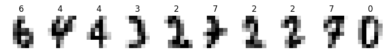
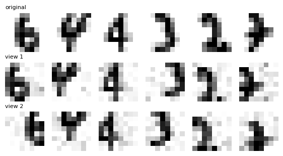
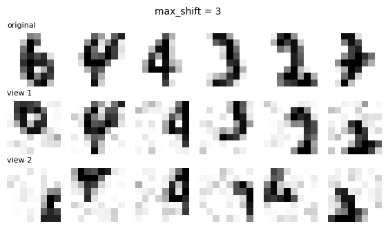
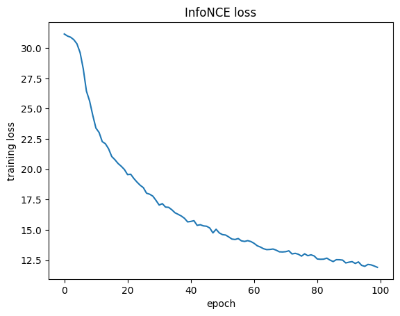
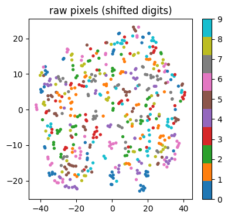
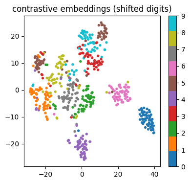
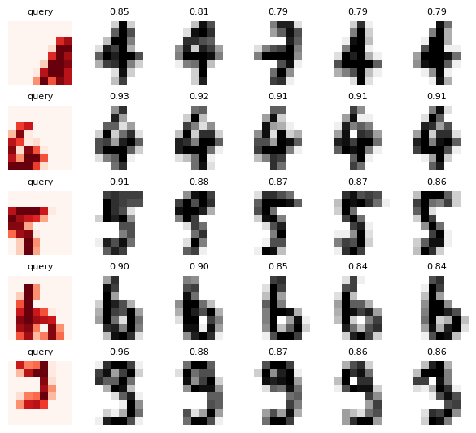
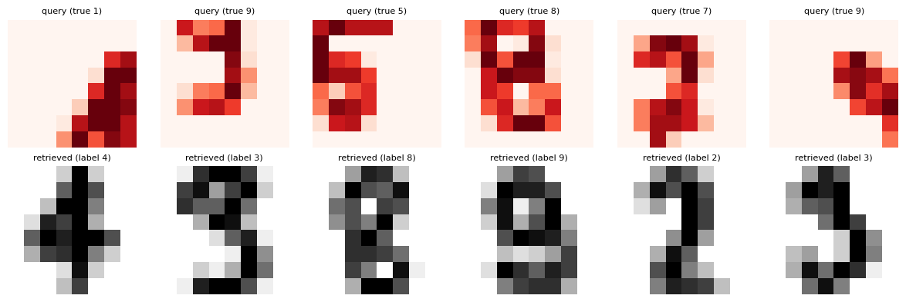

# Contrastive Learning: Embeddings Without Labels

I trained a small neural network to turn images into embeddings **without ever showing it a label**, using contrastive learning (the InfoNCE loss). Then I tested what it had learned, and ran three experiments that break or change the setup on purpose.

This started as a hands-on lab in my AI course at FAST-NUCES Karachi. The lab notebook came with working code for every step. I ran it end to end, and wrote the extra pieces listed below myself. The lab manual is not included.

## The idea

For every image, the model sees two randomly altered versions of it (the **positive pair**). All the other images in the batch are **negatives**. The loss pulls the two views of the same image together and pushes everything else apart. The "label" for each image is simply: your other view is your positive, everyone else is a negative.

## The setup

- **Data:** scikit-learn digits, 1,797 handwritten digits, each an 8x8 grey-scale image. 1,257 for training and 540 for testing.
- **Augmentation:** a random shift of up to 2 pixels in each direction, plus a little Gaussian noise. Two calls on the same image give two different views.
- **Encoder:** a small MLP, 64 pixels in, 32-number embedding out, normalised to length 1 so a dot product is the cosine similarity.
- **Loss:** InfoNCE with temperature 0.1, batch size 256, Adam, 100 epochs. The labels are used only at the end, to measure quality.

Every digit is still recognisable in both views, but the pixels differ a lot. I also compared `max_shift` of 0, 2 and 3. At 3, parts of the digit fall off the 8x8 image (the 6 in the first column is mostly cut off in view 2), so the two views stop showing the same thing. I kept 2.

## What I added

The notebook came with the code for all the tasks. These pieces are mine:

- The `max_shift` comparison for Task 2 (0, 2, 3) and my written choice
- The temperature experiment, changed to save its results in a dictionary
- A cell that builds the two results tables from the saved models
- A top-1 retrieval check over all 540 shifted test images, which finds and plots the mistakes
- A search helper for the optional text-embedding extension, with my own queries
- Written predictions and answers to the lab questions, based on my own run

## Results

Evaluation uses k-nearest-neighbour accuracy (k = 5, cosine distance) on features from the training set. "Shifted" means every test image was moved by up to 2 pixels.

| Features | Clean test | Shifted test |
|---|---|---|
| Raw pixels | 0.978 | 0.270 |
| Untrained encoder | 0.952 | 0.200 |
| Contrastive encoder (tau 0.1) | 0.937 | **0.894** |

Raw pixels are the best on perfectly centred digits, but fall apart when a digit moves by a pixel or two. The contrastive encoder was trained to treat shifted views as the same image, so it barely notices the shift. It is a little worse on clean images (0.937 vs 0.978), because it squeezes the image into 32 numbers and was trained to ignore some detail.

Average cosine similarity between pairs of test images:

| | Positive pairs | Negative pairs |
|---|---|---|
| Untrained encoder | 0.8936 | 0.8869 |
| Contrastive encoder | 0.8489 | 0.0074 |
| No negatives (Experiment A) | 1.0000 | 1.0000 |

Before training, everything looks similar. After training, the negatives sit near 0 while the positives stay close.

The untrained encoder's first loss was 6.24, which matches log(2n - 1) = log(511) for a batch of 256. That is what random guessing among 511 candidates gives. The loss then fell steadily during training.

The y-axis is the sum over the 5 batches in an epoch, so it starts near 5 x 6.24 = 31.

## Experiment A: remove the negatives

I replaced InfoNCE with a loss that only pulls the two views together.

| | Positive pairs | Negative pairs | Shifted test accuracy |
|---|---|---|---|
| With negatives | 0.8489 | 0.0074 | 0.894 |
| No negatives | 1.0000 | 1.0000 | 0.156 |

Both similarities went to exactly 1.0000. The easiest way to make two views close is to map every image to the same point, so the loss is perfect but the embedding is useless. This is called **collapse**. Negatives prevent it, because if everything sits at one point, the negatives look as similar as the positive and the loss becomes large.

## Experiment B: temperature

Shifted-test accuracy, 50 epochs each:

| tau | 0.05 | 0.1 | 0.5 | 1.0 |
|---|---|---|---|---|
| Accuracy | 0.856 | 0.859 | 0.769 | 0.704 |

Small temperatures work best, and accuracy drops as tau grows. The embeddings have length 1, so similarities only range from -1 to 1. With a large tau the softmax is nearly flat, so the loss cannot sharply separate the positive from the negatives, and it stops focusing on the most confusing ones. The difference between 0.05 and 0.1 is 0.003, which is about 2 test images out of 540, so I treat those two as a tie.

## Experiment C: the augmentation decides what is learned

I trained with noise only, no shifting.

| | Clean test | Shifted test |
|---|---|---|
| Trained with shifts + noise | 0.937 | 0.894 |
| Trained with noise only | 0.967 | 0.241 |

The noise-only model is better on clean digits and collapses on shifted ones. A contrastive model becomes insensitive to exactly the changes used to build the positive pairs. Choosing the augmentation is choosing what "similar" means.

## What the embeddings look like

The two plots below are t-SNE maps of the shifted test digits, coloured by true label (the labels only colour the points).

Raw pixels:

Contrastive embeddings:

Raw pixels are scattered, with no clear groups. The contrastive embeddings form groups, even though the encoder never saw a label. Digits 0, 4 and 6 form clean islands, while several others sit next to each other or are split into two groups.

## Retrieval

For five shifted query images (true digits 1, 4, 5, 6 and 9), I retrieved the 5 most similar training images by cosine similarity. This is the same thing a vector database does with text embeddings in RAG and agent memory.

Over all 540 shifted test images, the top-1 retrieval was wrong **67 times (12.4%)**. Here are the first six mistakes:

The mistakes look reasonable. A true 1 pushed against the right edge retrieved a 4, since both are dominated by one long vertical stroke. A true 8 retrieved a 9, and both have a closed loop at the top. After shifting, the details that separate these digits are weak.

## Optional: text embeddings

The last cells load `all-MiniLM-L6-v2`, a pretrained sentence encoder that was itself trained with a contrastive loss on sentence pairs. For the query "How do I reset my password?":

| Score | Document |
|---|---|
| 0.77 | Steps to change your account password |
| 0.60 | Forgot your login? Recover access here |
| 0.04 | Our office is closed on public holidays |
| 0.01 | Quarterly sales report for 2025 |

The "Forgot your login?" document shares almost no words with the query, but it still ranks second because the meaning is close. This is also the limit of embedding search: it matches meaning, not exact strings. For an exact value like an ID (`K00314`), exact text search such as `grep` is the right tool, because two similar-looking IDs can get almost the same embedding.

## Running it

1. Open the notebook in Google Colab (the badge at the top does this). A CPU runtime is enough.
2. Run the cells from top to bottom. The whole notebook takes a few minutes.
3. The optional text cell at the end needs internet access, because it downloads a model of about 90 MB.

## Notes

- Every number comes from a single run with one seed. Small differences, like the 0.003 gap between tau 0.05 and 0.1, are within noise.
- The main contrastive row (0.894) was trained for 100 epochs. The temperature, no-negatives and noise-only experiments used 50 epochs, so compare those with each other. At 50 epochs, tau 0.1 gives 0.859.
- The model is a tiny MLP on 8x8 digits. The results show how the idea works, not how it performs on real photos.
- The starter code was provided by the course. The extra experiments, plots, tables, and written answers are my own.
