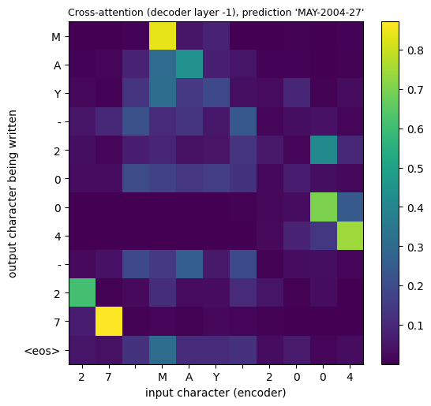
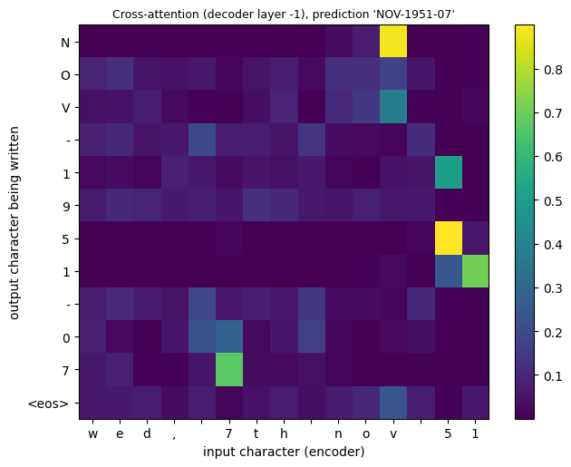
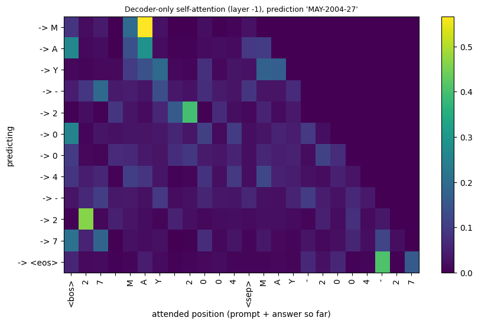
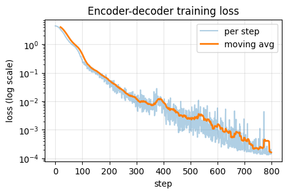
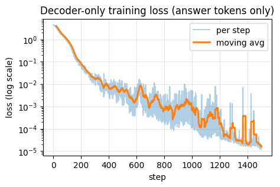

# Encoder-Decoder vs Decoder-Only Transformer

I built two small transformers and trained both on the same task, to see what actually changes between the two designs:

- an **encoder-decoder** (the original 2017 design, still used in T5 and Whisper)
- a **decoder-only** model (the design behind GPT-style LLMs)

Because both models learn the same task from the same data, any difference comes from the architecture.

This started as a hands-on lab in my AI course at FAST-NUCES Karachi. It came with a starter notebook, and I wrote the core pieces myself (listed below). The lab manual is not included.

## The task

Both models turn messy, human-written dates into one clean format. My version of the task outputs month, year, day with a `-` separator and a 3-letter month.

| Input | Output |
|---|---|
| `Wed, May 16th, 2046` | `MAY-2046-16` |
| `28TH MAY 03` | `MAY-2003-28` |
| `wed, 7th nov 51` (held-out format) | `NOV-1951-07` |
| `March 18, 93` (held-out format) | `MAR-1993-18` |

- 40,000 training examples, 2,000 validation, 1,000 held-out. Character-level vocabulary of 73.
- 4 of the 24 input text formats are hidden from training, to test how well the models generalise.
- Two-digit years are expanded with a fixed rule: 50 to 99 means 1950 to 1999, and 00 to 49 means 2000 to 2049.

## What I implemented

- Scaled dot-product attention with boolean masks (checked against PyTorch's own version)
- Padding mask and causal mask
- Decoder layer with causal self-attention, cross-attention and a feed-forward block
- Teacher forcing (shifting the target to make the decoder input)
- Greedy decoding for both models
- Decoder-only block, and packing each example as `<bos> input <sep> answer <eos>` with the loss applied only to the answer
- Prompted generation for the decoder-only model

The multi-head attention wrapper, the encoder layer, the training loop and the plotting code came with the starter notebook.

## Results

| | Encoder-decoder | Decoder-only |
|---|---|---|
| Parameters | 953,161 | 1,018,569 |
| Training steps | 800 | 1500 |
| Training time (s) | 17 | 44 |
| Time per step (ms) | 22 | 29 |
| Validation exact match | 100.0% | 99.9% |
| Held-out exact match | 99.9% | 99.7% |
| Positions for one example | 15 encoder + 12 decoder | 28 in one sequence |
| Input reaches the output via | cross-attention | causal self-attention |

Exact match means the whole date must be right. Both models are very accurate. On this narrow task the encoder-decoder is cheaper: fewer steps, less time, and the same accuracy. The gap on held-out formats is 2 examples out of 1000, so I treat it as a tie.

Held-out mistakes were few:
- Encoder-decoder: `August 9, 10` gave `AUG-1990-09` instead of `AUG-2010-09` (a 2-digit year read in the wrong century).
- Decoder-only: a wrong day twice (`21` to `22`, `06` to `03`) and one wrong century (`91` to `2091`).

## Experiment A: break the masks on purpose

Three short runs (400 steps each, same seed): a control, one without the causal mask, and one without the padding mask.

| Run | Final training loss | Validation exact match |
|---|---|---|
| Control (both masks) | 0.0062 | 98.0% |
| No causal mask | 0.0011 | **0.0%** |
| No padding mask | 0.0236 | 92.0% |

Without the causal mask, the training loss was the lowest of the three, but the model failed completely at generation (outputs like `AAR-2020-20`). During teacher forcing, the decoder could look at the next correct character and just copy it. At generation time that character does not exist yet, so nothing is left to copy.

Without the padding mask, the model still learns, only more slowly and less accurately, because it has to learn to ignore the `<pad>` tokens that now take attention weight.

## Experiment B: loss on the answer only vs on every token

Decoder-only model, 1500 steps. "Answer-only" is like fine-tuning on instructions. "Every token" also predicts the messy input, like pre-training.

| | Answer-only | Every token |
|---|---|---|
| Final training loss | 0.0000 | 0.5580 |
| Validation exact match | 99.9% | 100.0% |
| Held-out exact match | 99.7% | 99.7% |

The every-token loss is much higher because parts of the input cannot be predicted: the date itself is random, and so are the casing and the style. The two runs were equally accurate on held-out formats, so in my run predicting the inputs did not give a clear gain. The loss values also cannot be compared directly, because they are measured over different sets of tokens.

## What the models learned to look at

### Encoder-decoder cross-attention

Each row is an output character being written. Each column is an input character.

Input `27 MAY 2004`, output `MAY-2004-27`:

The month letters look at the month name, the day digits copy the day, and the last two year digits look at the year. My output order (month, year, day) differs from the input order (day, month, year), so the bright cells jump around instead of following a diagonal.

A held-out example, `wed, 7th nov 51`, output `NOV-1951-07`:

The month attends to the `v` of `nov`. The year digits copy `51`, and the model decides on `19` from the `5`, which matches the 50 to 99 rule.

### Decoder-only attention

There is no cross-attention here. The answer characters look back at the prompt through ordinary causal self-attention, and also at the answer written so far.

## Training curves

The decoder-only loss fell more slowly at first (0.8144 vs 0.2590 at step 100) and needed more steps overall.

## Why the decoder-only version is slower per step

For one example, the encoder-decoder processes 15 + 12 positions and the decoder-only model processes 28, so the content is about the same. The difference is the compute. In training both are padded: the encoder-decoder uses 40 + 16 positions with 2 encoder and 2 decoder layers, while the decoder-only model runs one 56-position sequence through 5 layers. By my own estimate that is about 112 vs 280 token-layers. The measured gap (22 ms vs 29 ms) is smaller than that suggests, probably because tiny models on a GPU are dominated by overhead.

## Running it

1. Open the notebook in Google Colab and select a T4 GPU.
2. Set `STUDENT_ID` in the first cells to any ID you like. The task (output format, held-out formats, seed) is generated from this ID, so your numbers will differ from mine.
3. Run the cells from top to bottom. The two training runs take under a minute each on a T4.

## Notes

- Every number comes from a single run with one seed. A 0.2 point difference is 2 examples out of 1000, so I would not read much into it.
- In Experiment A, the control run uses 400 steps (half of the main run), which is why it scores 98.0% instead of 100%.
- Part of the lab (the starter code and the task generator) was provided by the course. The attention, masks, decoder layers, decoding and loss masking are my own code.
